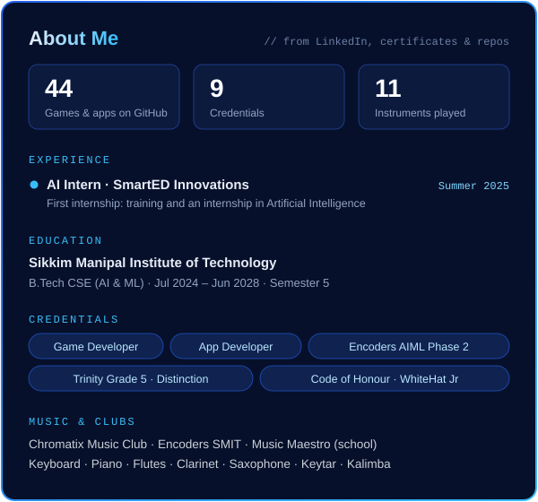

<div align="center">



<br/><br/>


</div>

<br/>

<div align="center">


</div>

<br/>

<div align="center">

## ⚡ Tech Stack

</div>

**Languages**


**Game Development**


**AI / ML**


**Tools**


**Music & Media**


<br/>

<div align="center">

## 🎮 Featured Games

*Built with JavaScript and p5.js. Each one is playable in the browser (click once to start, so the sound can load).*

</div>

<table>
<tr>
<td width="33%" valign="top">

### 🦸 Kill the Monster
Physics game on **Matter.js**: drag the mouse to fly Superman through tumbling box towers and defeat Bowser.

`Matter.js` `p5.js` `Physics`

[▶ Play](https://anitikaaronmaharana.github.io/Kill-The-Monster/) · [📂 Code](https://github.com/anitikaaronmaharana/Kill-The-Monster)

</td>
<td width="33%" valign="top">

### 🗝️ Treasure Hunt 2
Unscramble three programming words (with hints) to open Aladdin’s cave. A puzzle that teaches coding vocabulary.

`p5.js` `DOM inputs` `Puzzle`

[▶ Play](https://anitikaaronmaharana.github.io/Treasure-Hunt-2/) · [📂 Code](https://github.com/anitikaaronmaharana/Treasure-Hunt-2)

</td>
<td width="33%" valign="top">

### 🍎 Fruit Collector 2
A **real-time two-player** game: game state, player count and positions sync through **Firebase Realtime Database**.

`Firebase` `p5.play` `Multiplayer`

[▶ Play](https://anitikaaronmaharana.github.io/Fruit-Collector-2/) · [📂 Code](https://github.com/anitikaaronmaharana/Fruit-Collector-2)

</td>
</tr>
<tr>
<td width="33%" valign="top">

### 🎈 Air Balloon Ride
Steer a hot-air balloon over a city with the arrow keys. Its position is saved to Firebase, so it remembers where you left off.

`Firebase` `p5.js`

[▶ Play](https://anitikaaronmaharana.github.io/Hot-Air-Balloon/) · [📂 Code](https://github.com/anitikaaronmaharana/Hot-Air-Balloon)

</td>
<td width="33%" valign="top">

### 🦘 Kangaroo in the Jungle 2
Endless runner with a following camera, jump physics (space bar), obstacle groups and sound effects.

`p5.play` `Camera` `Runner`

[▶ Play](https://anitikaaronmaharana.github.io/Kangaroo-Game-2/) · [📂 Code](https://github.com/anitikaaronmaharana/Kangaroo-Game-2)

</td>
<td width="33%" valign="top">

### 🧟 Zombie Shoot II
Survival shooter: dodge villains, zombies and squids while the score climbs. Keyboard and touch controls.

`p5.play` `p5.sound` `Arcade`

[▶ Play](https://anitikaaronmaharana.github.io/Zombie-Shoot-II/) · [📂 Code](https://github.com/anitikaaronmaharana/Zombie-Shoot-II)

</td>
</tr>
</table>

<p align="center">🕹️ <b>44 games & apps</b> in total on <a href="https://github.com/anitikaaronmaharana?tab=repositories">@anitikaaronmaharana</a> · 💙 Portfolio source: <a href="https://github.com/Anitik-Aaron-Maharana/Portfolio">Anitik-Aaron-Maharana/Portfolio</a></p>

<br/>

<div align="center">

## 💼 Experience

</div>

| Role | Organisation | Period |
| :-- | :-- | :-- |
| **Artificial Intelligence Intern**: training + internship | **SmartED Innovations** | Summer 2025 *(certificate 01 Aug 2025)* |

<br/>

<div align="center">

## 🎓 Education

</div>

| Institution | Programme | Period |
| :-- | :-- | :-- |
| **Sikkim Manipal Institute of Technology** | B.Tech, Computer Science (AI & ML specialisation) · Chromatix Music Club, Encoders SMIT | Jul 2024 – Jun 2028 |
| **Sri Sri Academy**, Siliguri | Standard XII, CBSE | Apr 2019 – Mar 2024 |
| **WhiteHat Jr** | Certification in Game & App Development | Jan 2020 – Dec 2021 |
| **Trinity College London** | Electronic Keyboard: Level 1 (Grade 3) & Level 2 (Grade 5) | Jan 2020 – Jun 2024 |

<br/>

<div align="center">

## 🏅 Certifications & Awards

</div>

| Credential | Issuer | Date |
| :-- | :-- | :-- |
| AIML Phase 2 | Encoders SMIT · ACCESS | Mar 2025 |
| Industry Academia Series (participation) | SIGIL · ACCESS | Mar 2025 |
| Grade 5 Electronic Keyboard, **Distinction** | Trinity College London | Aug 2024 |
| Music Maestro | Sri Sri Academy | 2022–23 |
| Code of Honour: Top Independent Game Developers | WhiteHat Jr | Jan 2022 |
| Grade 3 Electronic Keyboard, **Distinction** | Trinity College London | Jan 2022 |
| Certified Mobile App Developer | WhiteHat Jr | Aug 2021 |
| First Place, Essay Writing | Sri Sri Academy | Jan 2021 |
| Certified Game Developer | WhiteHat Jr | Nov 2020 |

<br/>

<div align="center">

## 📊 GitHub Analytics

*Stats from my game-dev account, [@anitikaaronmaharana](https://github.com/anitikaaronmaharana), where the 44 projects live.*


</div>

<br/>

<table>
<tr>
<td width="33%" valign="top">

### 🏆 Journey
- **2020:** Certified Game Developer · Essay Writing, 1st place
- **2021:** Certified Mobile App Developer
- **2022:** Code of Honour · Trinity Grade 3 (Distinction)
- **2022–23:** School Music Maestro
- **2024:** Trinity Grade 5 (Distinction) · Joined SMIT
- **2025:** Encoders AIML · SIGIL · **First internship (AI)** 🚀

</td>
<td width="33%" valign="top">

### 🗺️ Learning Roadmap
- ✅ **Game development:** WhiteHat Jr certified
- ✅ **App development:** WhiteHat Jr certified
- ✅ **AIML Phase 2:** Encoders SMIT
- 🔄 **AI & ML:** B.Tech specialisation, semester 5
- 🔄 **Python for AI:** after the SmartED internship
- 🔄 **Keyboard:** Trinity final level in preparation

</td>
<td width="33%" valign="top">

### 🎯 Current Focus

```js
while (curious) {
  learn();   // AI, ML, Python
  build();   // games & apps
  play();    // 11 instruments
  repeat();
}
// "Music in the soul can
//  be heard by the universe."
```

</td>
</tr>
</table>

<br/>

<div align="center">

## 🌐 Let's Connect

[](https://www.linkedin.com/in/anitikaaronmaharana/)
[](https://github.com/anitikaaronmaharana)
[](mailto:anitikamaharana@gmail.com)
[](https://youtube.com/AnitikAaronMaharana)
[](https://github.com/Anitik-Aaron-Maharana/Portfolio)

**Open to internships, collaborations and jam sessions. Let’s build something meaningful! 🎹💡**


</div>
